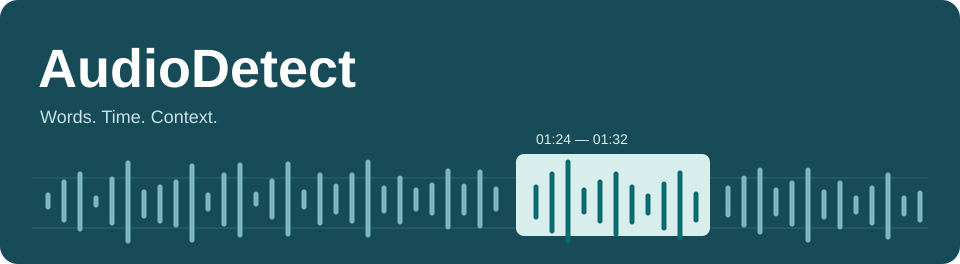
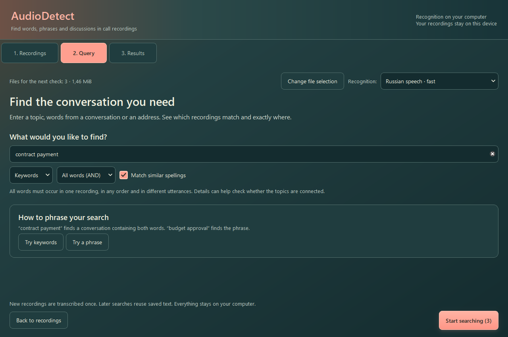
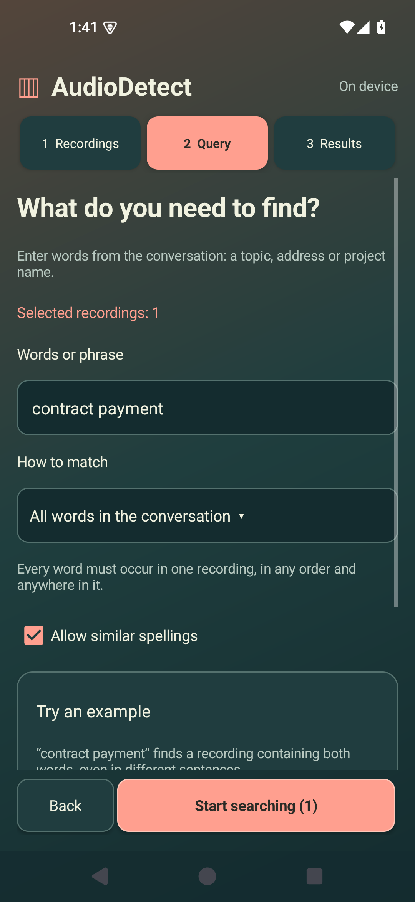
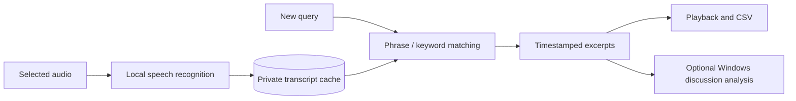

<b>English</b> · <a href="README.ru.md">Русский</a> 
<a href="https://github.com/Tefoke1/AudioDetect/releases">Download Windows ZIP / Android APK</a> · <a href="LICENSE">GPLv3</a> · Local recognition

AudioDetect searches recorded conversations for words and phrases, then shows **file → timestamp → excerpt → brief**. Import recordings, combine filters, check a group of files and search. Your audio stays on your device.

Interface preview

Windows interface with fictional example text.

## Get started

**Windows 10/11, x64:** download the portable ZIP, extract the entire folder to a writable location and run `AudioDetect.exe`. No Python or installer is required. Choose Russian or English at launch. The included GigaAM models recognize Russian; choose a Whisper model for automatic speech-language detection. Whisper downloads its model on first use.

**Android 8 or newer:** download and install the APK, permitting installation from the app used to open it if Android asks. Russian and English speech models are included. Choose the interface language, add a folder or files, select the spoken language and check the recordings. Android recognition is independent of a computer and works offline from the first launch.

Windows builds are not Authenticode-signed. Android releases use a dedicated project signing key. Verify downloads against the release `SHA256SUMS.txt`.

**Three steps:** 1. Check recordings → 2. Enter a query → 3. Listen to matches or save the table. Each step provides guidance and examples.

## Find what matters

| Task | How it works |
|---|---|
| Choose recordings | Combine name, modification date and size filters; bulk-check the visible list. Windows also supports Shift/Ctrl ranges, status filters and filename patterns. Android supports long-press range selection. |
| Search a phrase | Match nearby words, inflections and optional similar spellings. Use `budget approval; revised deadline` for alternatives. Numbers must match. |
| Search keywords | **All words** must occur somewhere in the same recording, or **Any word** selects recordings with at least one term. Words may occur in separate discussions. |
| Review evidence | Read source excerpts, play the relevant audio and export a four-column CSV. |
| Examine a discussion | Windows: select matches and request local discussion analysis. Android: open nearby speech with an extractive quote; automatic topic-boundary analysis is not included. |

Search is based on recognized words. It does **not** guarantee conceptual matches when the query's words are absent. Recognition mistakes can produce missed or incorrect matches. No matches is a valid result; the app also reports recordings still awaiting transcription.

## Two stages, less repeated work

Windows uses GigaAM CTC through ONNX Runtime, with DirectML acceleration and an int8 CPU fallback; Whisper is an alternative. Overlapping audio windows bound inference work and preserve boundary words. A separate worker process makes cancellation independent of the current inference call. Android uses Vosk in a separate foreground process, processing up to two recordings concurrently and reducing concurrency under thermal, battery or memory pressure. Cached queries skip model loading; Stop terminates the recognition process.

Transcripts are reused for later queries. Discussion analysis runs only on chosen matches, using a local Qwen model through llama.cpp. The optional model download is about 2.5 GB. Briefs quote the source; generated boundaries are checked against source utterances. Speed depends on **audio duration**, model, device, codec and speech quality—not only file size. There is no universal 500-file timing guarantee.

## Privacy and security

- No accounts, analytics, audio uploads or cloud inference. The Android manifest has **no internet or microphone permission**. It accesses files granted through the system picker and disables application backup.
- Windows downloads optional components from their upstream hosts. Pinned GigaAM and analysis downloads are checked with SHA-256; Whisper uses the upstream model downloader. The local analysis server binds only to loopback and uses a random access key.
- Windows stores transcripts, settings and logs in the portable `data/` folder. Android stores its cache in app-private storage. These files are **not encrypted by AudioDetect**. Exported files contain conversation text and filenames; keep them private.
- The public source and release packages contain no recordings, transcripts, contact names, working databases, local configuration or signing keys. Tests use fictional text. See [release checks](docs/RELEASING.md).

## Source map

| Area | Files |
|---|---|
| Desktop UI and file selection | `app.py`, `catalog.py`, `file_filters.py`, `i18n.py` |
| Search, cache and exports | `core.py`, `briefs.py` |
| Recognition and isolation | `engine.py`, `fast_asr.py`, `audio_io.py`, `pipeline_worker.py`, `process_control.py` |
| Local discussion analysis | `semantic.py`, `semantic_assets.py` |
| Android | `android/app/src/main/java/org/audiodetect/app/` |
| Build and verification | `tools/`, `*.spec`, `test_*.py`, Android unit tests |

[Performance and phone testing](docs/PERFORMANCE.md) · [Interface system](docs/DESIGN.md) · [Build from source](docs/BUILD.md) · [Third-party components](THIRD_PARTY.md) · [Release checks](docs/RELEASING.md)

AudioDetect code is licensed under **GNU GPL version 3**. Distributed derivative applications must comply with GPLv3, including its source-distribution requirements. Libraries and model weights retain their own licenses.
