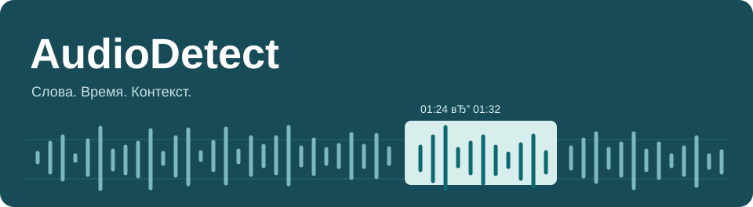
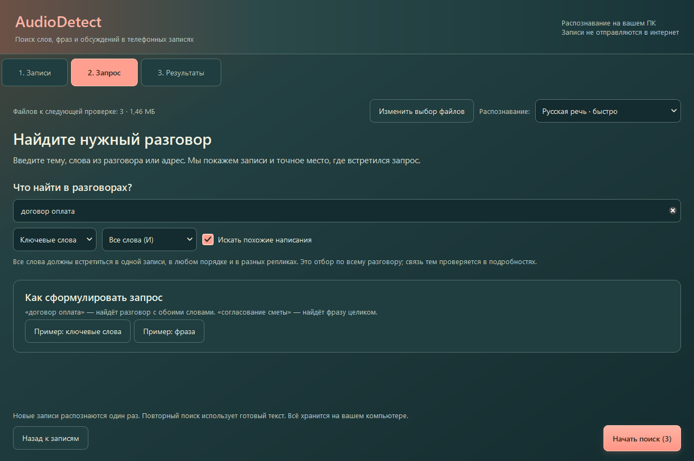
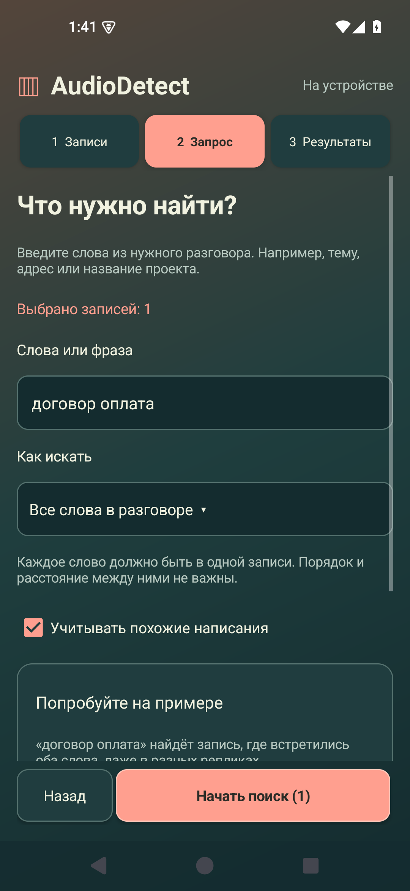
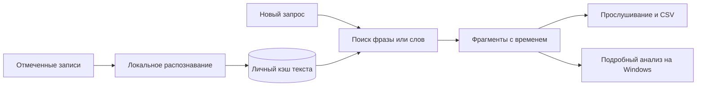

<a href="README.md">English</a> · <b>Русский</b> 
<a href="https://github.com/Tefoke1/AudioDetect/releases">Скачать ZIP для Windows / APK для Android</a> · <a href="LICENSE">GPLv3</a> · Локальное распознавание

AudioDetect ищет слова и фразы в записанных разговорах и показывает **файл → время → фрагмент → краткое описание**. Добавьте записи, совместите фильтры, отметьте группу файлов и задайте запрос. Аудио остаётся на вашем устройстве.

Как выглядит программа

Интерфейс Windows на вымышленном примере.

## Начало работы

**Windows 10/11, x64:** скачайте переносимый ZIP, распакуйте всю папку в место с правом записи и запустите `AudioDetect.exe`. Устанавливать Python или программу не нужно. При запуске выберите русский или английский интерфейс. Включённые модели GigaAM распознают русскую речь; для автоматического определения языка выберите Whisper. Его модель скачивается при первом использовании.

**Android 8 и новее:** скачайте и установите APK. Если Android запросит разрешение на установку из приложения, которым открыт файл, предоставьте его. Русская и английская модели уже включены. Выберите язык интерфейса, добавьте папку или файлы, укажите язык речи и запустите проверку. Телефон работает самостоятельно, без компьютера и интернета уже с первого запуска.

Сборка Windows не подписана сертификатом Authenticode. APK подписан отдельным ключом проекта. Контрольные суммы опубликованы в файле `SHA256SUMS.txt` рядом со сборками.

**Три шага:** 1. Отметьте записи → 2. Введите запрос → 3. Прослушайте найденное или сохраните таблицу. Подсказки и примеры находятся на каждом шаге.

## Как искать

| Задача | Возможности |
|---|---|
| Отобрать записи | Совместные фильтры по названию, дате изменения и размеру; массовая отметка видимого списка. Windows также поддерживает Shift/Ctrl, фильтр состояния и шаблоны имён. На Android долгое нажатие отмечает диапазон. |
| Найти фразу | Слова рядом, словоформы и необязательный поиск похожих написаний. Варианты разделяются `;`: `согласование сметы; перенос сроков`. Числа сравниваются точно. |
| Найти ключевые слова | **Все слова** должны встретиться в одной записи; режим **Любое слово** допускает хотя бы одно. Совпадения могут относиться к разным темам разговора. |
| Проверить результат | Исходные фрагменты, прослушивание нужного места и экспорт таблицы из четырёх столбцов. |
| Разобрать обсуждение | Windows: выделите результаты и запустите локальный подробный анализ. Android: ближайшие реплики и краткая цитата; автоматического определения границ темы пока нет. |

Поиск опирается на распознанные слова. Он **не гарантирует поиск по смыслу**, если слов запроса в тексте нет. Ошибки распознавания могут приводить к пропускам и неверным совпадениям. Нулевой результат допустим; количество ещё не распознанных файлов показывается отдельно.

## Два этапа обработки

Windows использует GigaAM CTC через ONNX Runtime: ускорение DirectML и резервный режим int8 на процессоре. Альтернатива — Whisper. Перекрывающиеся окна ограничивают объём вычислений и сохраняют слова на стыках. Отдельный процесс позволяет остановить работу, не дожидаясь завершения текущего вычисления. Android использует Vosk в отдельном процессе с уведомлением: до двух записей одновременно, с уменьшением нагрузки при нагреве, энергосбережении или нехватке памяти. Повторный запрос по готовому тексту не загружает модель.

Повторные запросы используют готовые расшифровки. Подробный анализ запускается только для выбранных результатов: локальная Qwen через llama.cpp. Дополнительная модель занимает около 2,5 ГБ и скачивается отдельно. Краткое описание цитирует исходный текст; предложенные границы сверяются с репликами. Скорость зависит от **длительности аудио**, модели, устройства, кодека и качества речи, а не только от размера файлов. Универсального обещания времени для 500 файлов нет.

## Приватность и безопасность

- Нет аккаунтов, аналитики, отправки аудио и облачного распознавания. У Android-приложения **нет разрешения на интернет и микрофон**. Доступ к файлам предоставляет системный проводник; резервное копирование данных приложения отключено.
- Windows скачивает дополнительные компоненты с сайтов разработчиков. Зафиксированные компоненты GigaAM и анализа проверяются по SHA-256; Whisper использует штатный загрузчик моделей. Сервер анализа доступен только внутри компьютера и защищён случайным ключом.
- Windows хранит текст, настройки и журналы в папке `data/` рядом с программой. Android — в закрытом хранилище приложения. AudioDetect **не шифрует эти данные**. Экспорт содержит текст разговоров и имена файлов: не публикуйте его случайно.
- В открытых исходниках и сборках нет пользовательских записей, расшифровок, контактов, рабочих баз, личных настроек и ключей подписи. Примеры в тестах вымышлены. [Проверки перед выпуском](docs/RELEASING.md).

## Структура проекта

| Область | Файлы |
|---|---|
| Окно программы и выбор файлов | `app.py`, `catalog.py`, `file_filters.py`, `i18n.py` |
| Поиск, кэш и экспорт | `core.py`, `briefs.py` |
| Распознавание и остановка | `engine.py`, `fast_asr.py`, `audio_io.py`, `pipeline_worker.py`, `process_control.py` |
| Локальный анализ обсуждений | `semantic.py`, `semantic_assets.py` |
| Android | `android/app/src/main/java/org/audiodetect/app/` |
| Сборка и проверки | `tools/`, `*.spec`, `test_*.py`, тесты Android |

[Скорость и проверка на телефоне](docs/PERFORMANCE.ru.md) · [Система интерфейса](docs/DESIGN.md) · [Сборка из исходников](docs/BUILD.md) · [Сторонние компоненты](THIRD_PARTY.md) · [Проверка выпуска](docs/RELEASING.md)

Код AudioDetect распространяется под **GNU GPL версии 3**. При распространении производных приложений необходимо соблюдать GPLv3, включая требования к предоставлению исходного кода. Библиотеки и модели сохраняют собственные лицензии.
